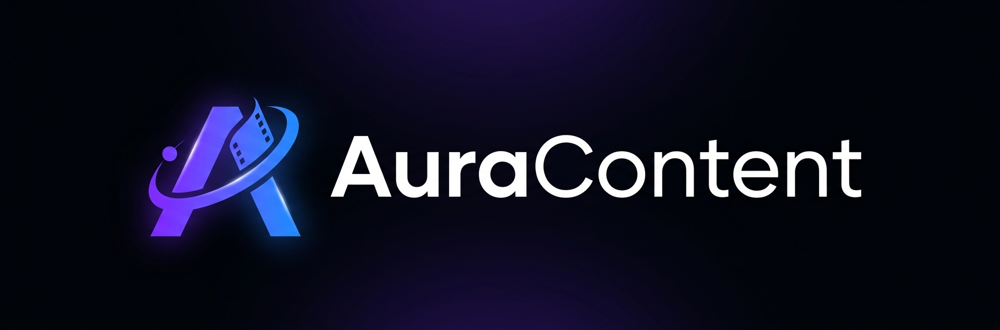

<p align="center">
  
</p>


<p align="center">
  <strong>Automated faceless short-video factory</strong>
</p>

<p align="center">
  From a channel config to a published YouTube Short / TikTok: script, voiceover, visuals, editing, storage and publishing — fully automated.
</p>

<p align="center">
  
  
  
  
  
  
</p>

---

## 📌 Table of Contents

- [Overview](#-overview)
- [Features](#-features)
- [Pipeline](#-pipeline)
- [Project Structure](#-project-structure)
- [Prerequisites](#-prerequisites)
- [Installation](#-installation)
- [Configuration](#-configuration)
- [Usage](#-usage)
- [GitHub Actions](#-github-actions)
- [Adding a Channel](#-adding-a-channel)
- [Troubleshooting](#-troubleshooting)
- [Contributing](#-contributing)
- [License](#-license)

---

## 🚀 Overview

**AuraContent** is a Python pipeline that produces and publishes short vertical videos (YouTube Shorts, TikTok) without a face on camera.

Each **channel** (e.g. `mystery` — short documentaries about real, little-known historical events in France) is described by a YAML file. For every run, the pipeline:

1. picks a topic and writes a fact-checked script with an LLM (sources: Wikipedia);
2. generates the narration (Gemini TTS, with `edge-tts` as fallback);
3. gathers visuals from stock, archive and AI image providers;
4. edits everything with FFmpeg (subtitles, music, transitions);
5. uploads the video and its caption to a Hugging Face dataset;
6. publishes it to YouTube and TikTok through the Zernio API.

Everything can run in **GitHub Actions**: no server required.

---

## ✨ Features

| Feature | Description |
|---|---|
| 🧠 **Multi-provider LLM** | ~10 providers (Gemini, Groq, Cerebras, Mistral, OpenRouter, DeepSeek, Cloudflare, GitHub Models, Z.ai, Qwen) with automatic fallback and rate-limit handling. Configure as many free tiers as you have. |
| 📚 **Fact-checked scripts** | Topics and facts are grounded on Wikipedia; locations are constrained per channel. |
| 🎣 **Hook optimisation** | A bandit tracker learns which hooks perform best using Zernio analytics. |
| 🗣️ **Voiceover** | Gemini TTS narration in a single request, split on silences; `edge-tts` fallback. |
| 🖼️ **Visuals** | Pexels, Pixabay, Wikimedia, Europeana, Internet Archive, Cloudflare FLUX and Pollinations, with local fallback images. |
| ✂️ **Automated editing** | FFmpeg composition with subtitles, background music, SFX and loudness check. |
| 🤗 **Shared state** | Videos, captions and history (used topics, hook stats) are synced to Hugging Face, so runs never repeat themselves. |
| 📱 **Publishing** | YouTube + TikTok via Zernio, with TikTok draft fallback. |
| 🩺 **Doctor** | A pre-flight command that really tests every key and fails fast in CI. |

---

## 🔄 Pipeline

```text
config/channels/<channel>.yaml
            │
            ▼
   Topic + script (LLM, Wikipedia)        auracontent/core/brain
            │
            ▼
   Voiceover (Gemini TTS / edge-tts)      auracontent/services/audios
            │
            ▼
   Visuals (stock / archives / AI)        auracontent/services/{scraping,visuals}
            │
            ▼
   Editing (FFmpeg)                       auracontent/services/video
            │
            ▼
   Upload video + caption (Hugging Face)  auracontent/services/publishing
            │
            ▼
   Publish (Zernio → YouTube, TikTok)     auracontent/cli/publish.py
```

---

## 🗂️ Project Structure

```text
auracontent_v2/
├── auracontent/
│   ├── cli/            # entry points: generate, publish, doctor
│   ├── core/           # pipeline + brain (LLM client, script generation)
│   ├── channels/       # one Brain per channel + registry
│   ├── services/       # audio, visuals, scraping, video, publishing
│   └── utils/          # subtitles, trackers, helpers
├── config/
│   ├── settings.py
│   └── channels/       # one YAML per channel (mystery, finance, kids)
├── assets/             # fonts, music, SFX, fallback images (per channel + shared)
├── scripts/            # standalone helpers (e.g. render_scene.py)
├── tests/
├── .github/workflows/  # generation, publishing, tests, release
├── init.sh             # Onyxia service bootstrap
├── packages.txt        # system packages (ffmpeg, fonts)
└── pyproject.toml      # dependencies (uv dependency groups)
```

---

## 🧰 Prerequisites

- **Python 3.10 – 3.12** (CI uses 3.12)
- **[uv](https://docs.astral.sh/uv/)**
- **FFmpeg** on your `PATH` (and the fonts listed in `packages.txt`)
- At least **one LLM API key**; Hugging Face and Zernio accounts to upload and publish

---

## 📦 Installation

```bash
git clone https://github.com/SORADATA/auracontent_v2.git
cd auracontent_v2

# system packages (Debian/Ubuntu)
sudo apt-get install -y $(grep -vE '^\s*(#|$)' packages.txt)

# Python dependencies
uv sync --group default --group media          # add --group dev for tests/linters
```

On an **Onyxia** service, `bash init.sh` does all of the above.

> The `ai` and `ui` groups are v1 leftovers and are not needed by the v2 pipeline.

---

## 🔐 Configuration

```bash
cp .env.example .env
```

Then fill in the keys you have. [`.env.example`](.env.example) documents every variable; the essentials are:

| Variable | Needed for |
|---|---|
| one of `GEMINI_API_KEY`, `GROQ_API_KEY`, `CEREBRAS_API_KEY`, … | script generation (**required**) |
| `WIKIMEDIA_CONTACT` | Wikipedia/Wikimedia User-Agent (strongly recommended) |
| `PEXELS_API_KEY`, `PIXABAY_API_KEY`, `POLLINATIONS_TOKEN`, … | visuals (optional, more = better) |
| `HF_TOKEN` | upload + state sync (`--upload`, `--sync-state`) |
| `ZERNIO_API_KEY_<CHANNEL>`, `TIKTOK_ACCOUNT_ID_<CHANNEL>`, `YOUTUBE_ACCOUNT_ID_<CHANNEL>` | publishing (e.g. `_MYSTERY`; names set in the channel YAML) |

Channel behaviour (duration, voice, topic rules, publishing targets…) lives in `config/channels/<channel>.yaml`. The YAML only contains the **names** of environment variables, never their values.

Check your setup:

```bash
uv run python -m auracontent.cli.doctor
```

---

## ▶️ Usage

```bash
# generate a video for every registered channel
uv run python -m auracontent.cli.generate

# one channel
uv run python -m auracontent.cli.generate mystery

# script only (no audio/video), handy to iterate on prompts
uv run python -m auracontent.cli.generate mystery --script-only

# as in CI: upload to Hugging Face and sync history
uv run python -m auracontent.cli.generate mystery --upload --sync-state

# publish the latest uploaded video of a channel
uv run python -m auracontent.cli.publish mystery
```

Outputs are written to `output/` and `temp/` (both git-ignored).

---

## ⚙️ GitHub Actions

| Workflow | Trigger | What it does |
|---|---|---|
| `generator_video.yml` | manual, `repository_dispatch` (`trigger-videos`) | doctor → generate → upload to HF |
| `publisher.yml` | manual | publishes the latest video via Zernio |
| `tests.yml` | push / PR | ruff + pytest |
| `release.yml` | push to `main` / `pre-release` | semantic-release: version, `CHANGELOG.md`, GitHub release |
| `test_zernio_con.yml` | manual | Zernio API connectivity check |

Add the variables from `.env.example` as **repository secrets** (Settings → Secrets and variables → Actions). `GITHUB_TOKEN` is provided automatically; `RELEASE_TOKEN` is a personal access token used by the release workflow.

---

## ➕ Adding a Channel

1. Create `config/channels/<name>.yaml` (start from `mystery.yaml`).
2. Create `auracontent/channels/<name>/brain.py` with a `BaseBrain` subclass.
3. Register it in `auracontent/channels/registry.py`.
4. Add its assets under `assets/<name>/`.

Currently registered: **`mystery`**. `finance` and `kids` have configs but are not yet ported to v2.

---

## 🛠️ Troubleshooting

| Symptom | Fix |
|---|---|
| `Aucun fournisseur LLM configuré` | set at least one LLM key, then run the doctor |
| HTTP 429 from an LLM | normal on free tiers: the client waits and falls back; add more providers |
| HTTP 402 on AI images | set `POLLINATIONS_TOKEN` or Cloudflare credentials |
| Cloudflare 401/403 | the token needs the **Workers AI** permission (an R2 token is not enough) |
| Wikipedia 403 | set `WIKIMEDIA_CONTACT` to a real contact |
| `ffmpeg` not found | install it (`packages.txt`) and make sure it is on your `PATH` |

---

## 🤝 Contributing

See [CONTRIBUTING.md](CONTRIBUTING.md). Commits must follow [Conventional Commits](https://www.conventionalcommits.org/): releases are computed from them.

---

## 📄 License

[MIT](LICENSE)
